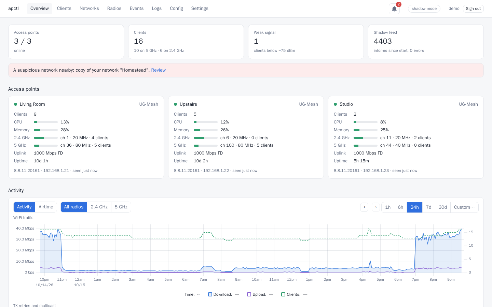
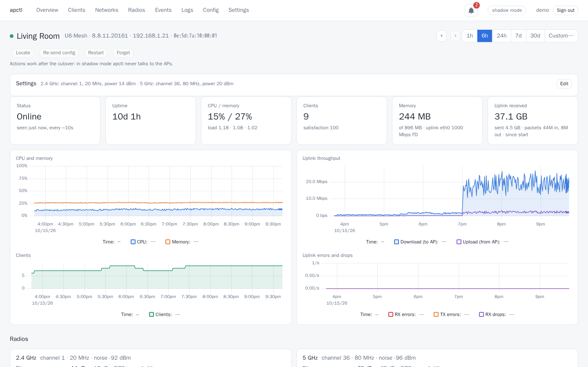
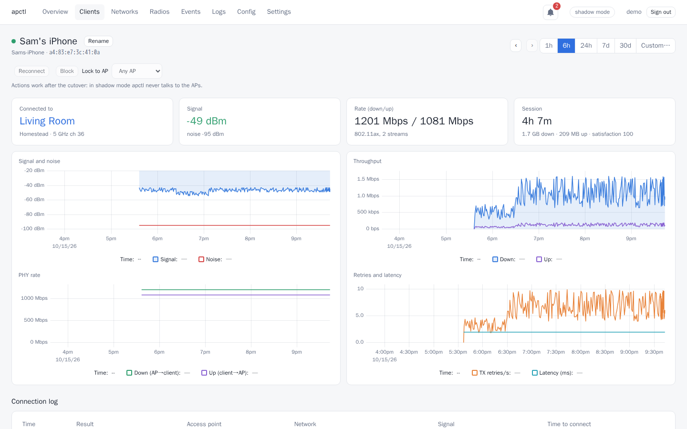
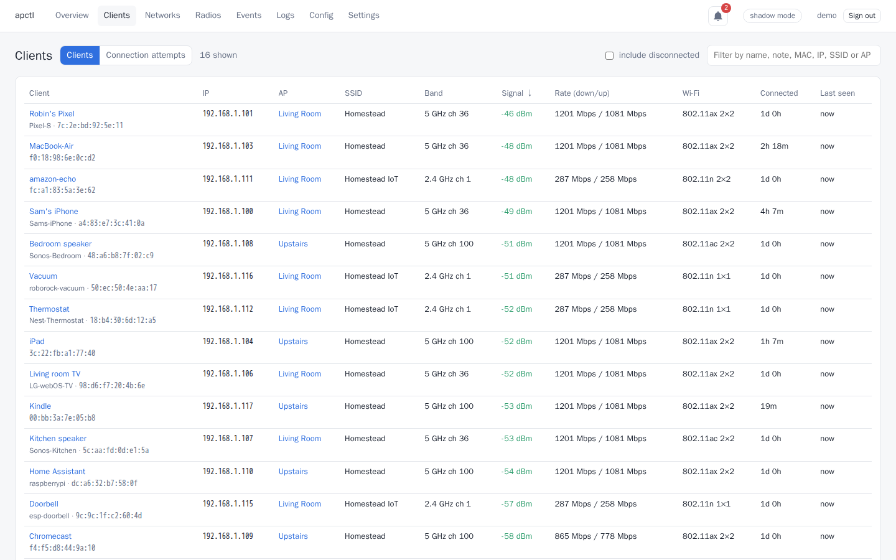
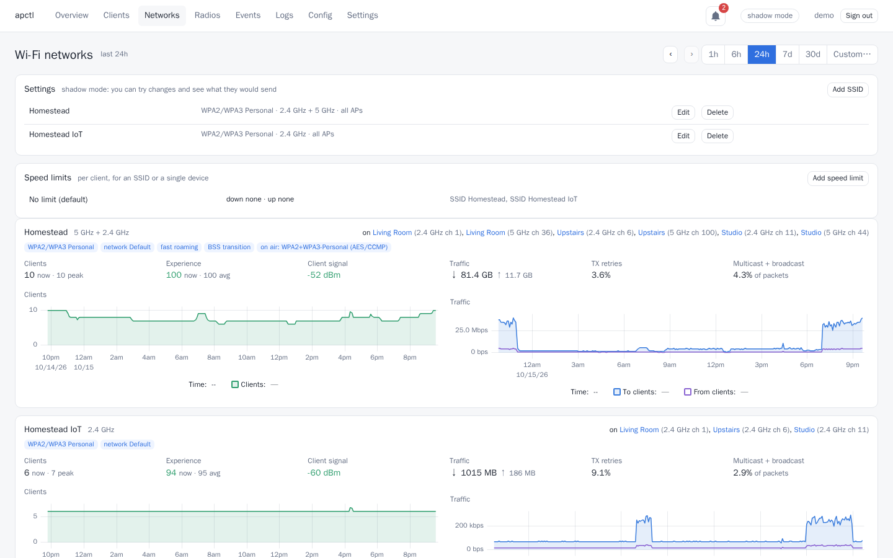
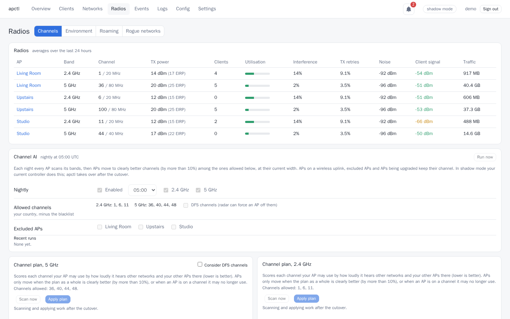
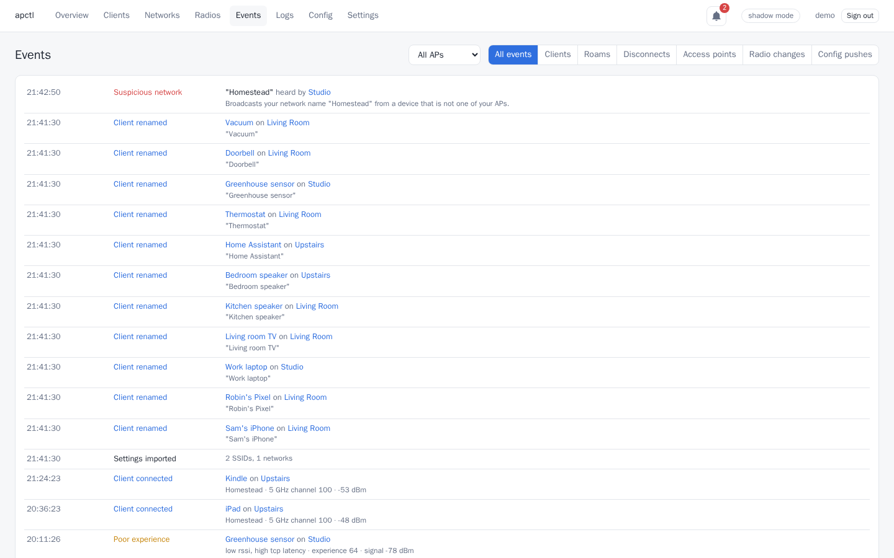

# rust-apctl

A lightweight, self-hosted controller for **UniFi access points**. It replaces the UniFi
Network Application on sites that only have UniFi APs. apctl is a single Rust binary with
an embedded web UI and stores everything in SQLite. It speaks the APs' own inform protocol,
so the APs need no changes.

> Not affiliated with Ubiquiti Inc. UniFi is a trademark of Ubiquiti Inc.



## Features

- Monitoring of APs, radios, networks and clients, with a year of history
- Events, browser alerts, a connection log with per-stage timings, and roaming analysis
- AP syslog with full-text search
- Neighbouring networks, channel planning and nightly auto-channel
- SSID, AP and site settings editors with per-AP previews, plus schedules, speed limits
  and SNMP
- Adoption, firmware upgrades, device and client actions, and encrypted backups

Tested with U6-Mesh APs on firmware 8.8, against Network Application 10.6.

| | |
|---|---|
|  |  |
|  |  |
|  |  |

These screenshots use mock data from `informdump demo`.

## Not supported yet

- **Wireless meshing.** apctl always sends the APs meshing off, whatever the imported
  settings say. Don't switch a site whose APs mesh (or need to) over to apctl yet.
- A tagged management VLAN, guest portals, Hotspot 2.0, and 6 GHz / Wi-Fi 7 features.

## Modes

- **Shadow** (default): learns everything from a packet capture of an existing
  controller's traffic and never talks to the APs. A dry run compares that controller's
  config pushes with apctl's.
- **Active** (`--active`): apctl is the controller. It uses 8080/tcp (inform),
  5514/udp (syslog) and 3478/udp (STUN), and takes over the APs' keys from
  `informdump import`. The configs it pushes name the ports it listens on, so APs
  sending syslog "to this controller" use the `--syslog-listen` port.

## Run

```sh
printf '%s' 'a long password' | docker run --rm -i ghcr.io/trexx/rust-apctl hash-password | sed 's/^/admin:/' > users
docker run -d -v apctl-data:/data -v $PWD/users:/users:ro -v $PWD/import.json:/import.json:ro -e APCTL_USERS_FILE=/users \
  -e APCTL_SYSLOG_LISTEN=0.0.0.0:5514 -p 8090:8090 -p 8080:8080 -p 5514:5514/udp -p 3478:3478/udp \
  ghcr.io/trexx/rust-apctl serve --active --keys /import.json
```

`import.json` is the snapshot `informdump import` wrote, readable only by its owner. The
container runs as uid 65532, which must be able to read it: `sudo chown 65532 import.json`
for Docker, `podman unshare chown 65532 import.json` for rootless Podman.

On Kubernetes (active mode), with the APs' ports on the node and the data on local storage:

```yaml
# kubectl create secret generic apctl --from-file=import.json --from-file=users
apiVersion: apps/v1
kind: StatefulSet
metadata: { name: apctl }
spec:
  serviceName: apctl
  selector: { matchLabels: { app: apctl } }
  template:
    metadata: { labels: { app: apctl } }
    spec:
      securityContext: { fsGroup: 65532 }
      containers:
        - name: apctl
          image: ghcr.io/trexx/rust-apctl:0.15.1
          args: [serve, --active, --keys, /secret/import.json, --users-file, /secret/users]
          env:
            - { name: APCTL_SYSLOG_LISTEN, value: "0.0.0.0:5514" }
          ports:
            - { name: http, containerPort: 8090 }
            - { name: inform, containerPort: 8080, hostPort: 8080 }
            - { name: syslog, containerPort: 5514, hostPort: 5514, protocol: UDP }
            - { name: stun, containerPort: 3478, hostPort: 3478, protocol: UDP }
          readinessProbe: { httpGet: { path: /healthz, port: http } }
          volumeMounts:
            - { name: data, mountPath: /data }
            - { name: secret, mountPath: /secret, readOnly: true }
      volumes:
        - { name: secret, secret: { secretName: apctl } }
  volumeClaimTemplates:
    - metadata: { name: data }
      spec: { accessModes: [ReadWriteOnce], resources: { requests: { storage: 2Gi } } }
```

Expose port 8090 with a Service for the web UI. For shadow mode, drop `--active` and the
host ports, and feed it a capture with `--shadow` or `--shadow-cmd`; the
`ghcr.io/trexx/rust-apctl-capture` image is a tcpdump sidecar for that. `apctl serve --help`
lists every option.

Without `--users-file` (`APCTL_USERS_FILE`), apctl is read-only and needs no login: anyone
who can reach port 8090 sees everything except the Wi-Fi passphrases, the SNMP community
and backup downloads.

Behind a reverse proxy or ingress, list its addresses with `--trusted-proxies`
(`APCTL_TRUSTED_PROXIES`, IPs or CIDR ranges). Only then is its `X-Forwarded-For` header
used, so the login throttle sees each client rather than the proxy.

## Demo

Try the UI without any APs. The demo is a made-up site with three APs and about twenty clients:

```sh
# Two builds: informdump turns on serde_json features that apctl is not built with.
cargo build --release -p controller
cargo build --release -p informdump
mkdir -p data   # git-ignored, and kept out of image builds
target/release/informdump demo-state > data/demo.json
target/release/apctl serve --data-dir data/demo --keys data/demo.json \
  --shadow-cmd "target/release/informdump demo --live"   # charts fill in after a minute or two
# Optional: upload data/demo.json on the Settings page for SSIDs and the settings editor.
```

## Build

```sh
podman run --rm -v $PWD/web:/app:Z -w /app docker.io/library/node:24-slim sh -c "npm ci && npm run build"
cargo build --release -p controller   # or: podman build --target runtime .
```

`crates/informdump` decodes, imports, sanitises and simulates inform traffic. Run
`informdump --help` for its commands. `informdump import` reads the official controller's
MongoDB and needs `cargo build --release -p informdump --features mongo`.

Pushing a version tag (e.g. `0.15.1`) makes CI publish the image; nothing else pushes it.
`scripts/release.sh 0.15.1` runs CI's checks and builds and checks the image locally before
the tag goes out, and `scripts/release.sh 0.15.1 --pin <manifest>` afterwards waits for
CI's image and pins its digest in a manifest.

## License

[MIT](LICENSE)
